# Legged Tactile: foot touch sensing for quadruped locomotion on ice, glue and everything in between

*Does a walking policy that can feel its feet do better when the ground's friction changes, and when does plain proprioception (joint encoders + IMU) win?*

I added four simulated foot sensors to a Unitree A1 PPO locomotion policy in Isaac Lab and trained six policies: proprioception only, each sensor alone, and all four together. I then tested all six on seven surfaces from extreme ice (μ = 0.01) to extra-sticky "glue" (μ = 5), on flat and rough ground, with healthy, noisy and dead sensors. That is 128 robots per surface and condition, 20 s each.

| | |
|---|---|
| 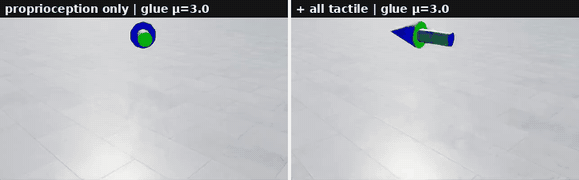 | 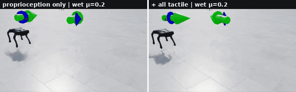 |

## TL;DR

1. **Touch helps most on wet, sticky and glue-like ground.** On flat ground, the all-tactile policy cuts velocity-tracking error from 0.432 to 0.339 m/s (-21 %) and walks 39 % further in 20 s (8.0 → 11.1 m). The gains are largest on wet (μ = 0.2, -37 % error), sticky (-44 %), glue (-39 %) and extra-sticky (-43 %). The proprioception-only policy gets *worse* on high-friction ground than on regular ground (0.22 → 0.30 m/s on glue). The tactile policy stays flat at about 0.18 m/s from μ = 0.8 to 5.
2. **On ice, touch can't create grip.** At μ = 0.05 the best a robot can do is accelerate at μg ≈ 0.5 m/s²; at μ = 0.01, ≈ 0.1 m/s². No policy tracks the 0.8 m/s command on either. Tactile sensing gives only small gains there: error 0.66 → 0.64 m/s on ice. The FSR on/off policy goes furthest: 4.6 m vs 2.9 m on ice, and 1.3 vs 0.7 m on extreme ice.
3. **On rough ground the benefit shrinks but falls drop.** Velocity error goes 0.674 → 0.638 m/s, distance 3.3 → 4.3 m, and the fall rate 3.5 % → 1.3 %.
4. **A simple binary FSR captures most of the benefit.** "+ FSR on/off" alone reaches 0.347 m/s against 0.339 for all four sensors combined. Raw FSR resistance is the next best. The slip and vibrotactile sensors alone help much less.
5. **Proprioception wins when the sensors fail.** With every tactile reading stuck at "no contact", the all-tactile policy freezes in place (0.03 m in 20 s, vs 8.0 m for proprioception only). The FSR-resistance policy also freezes. Sensor *noise* (5×, plus 10 % false readings) costs almost nothing. The policies are robust to noisy touch but have learned to trust it completely. More cases where proprioception wins are [below](#when-proprioception-wins).

---

## Contents
1. [Videos](#videos)
2. [Results and comparisons](#results-and-comparisons)
3. [When proprioception wins](#when-proprioception-wins)
4. [The sensors](#the-sensors)
5. [Setup and training](#setup-and-training)
6. [Reproducing everything](#reproducing-everything)
7. [Caveats and honest notes](#caveats-and-honest-notes)
8. [Original version of the project](#original-version-of-the-project)
9. [Repository layout](#repository-layout) · [Acknowledgements](#acknowledgements) · [Citation](#citation)

---

## Videos

Each clip is 8 s on flat ground: 4 s straight at 0.8 m/s, then a 0.5 rad/s turn. **Green arrow = commanded velocity, blue arrow = the robot's actual velocity**; the camera follows the robot. The numbers are the 128-robot, 20 s evaluation means. Full-quality MP4s of every clip are in [`media/videos/`](media/videos).

### Proprioception only (left) vs all tactile sensors (right), every surface

| surface | proprioception only · all tactile | measured (proprioception → tactile) |
|---|---|---|
| **extreme ice** μ = 0.01 | 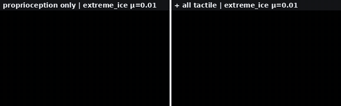 | error 0.77 → 0.75 m/s, distance 0.7 → 1.0 m |
| **ice** μ = 0.05 | 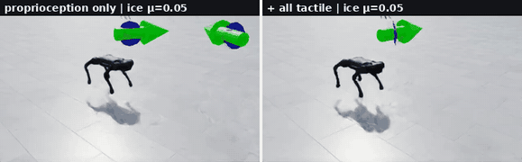 | error 0.66 → 0.64 m/s, distance 2.9 → 3.5 m |
| **wet** μ = 0.2 |  | error 0.45 → 0.28 m/s, distance 7.2 → 11.4 m |
| **regular** μ = 0.8 | 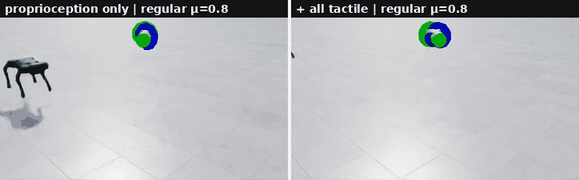 | error 0.22 → 0.16 m/s, distance 13.1 → 16.4 m |
| **sticky** μ = 2.0 | 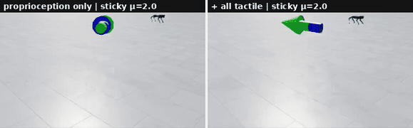 | error 0.32 → 0.18 m/s, distance 10.4 → 15.1 m |
| **glue** μ = 3.0 |  | error 0.30 → 0.18 m/s, distance 10.9 → 15.4 m |
| **extra sticky** μ = 5.0 | 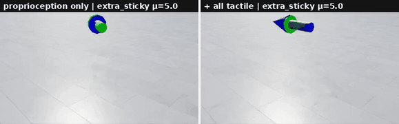 | error 0.31 → 0.18 m/s, distance 10.7 → 15.1 m |

### Rough ground

| ice, rough | glue, rough |
|---|---|
| 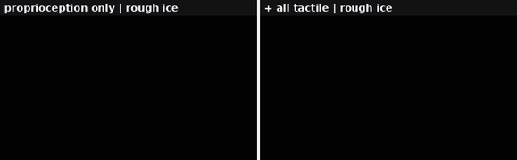 | 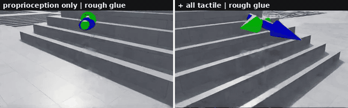 |

### Each sensor on its own (FSR on/off · FSR resistance · slip · vibrotactile)

| extreme ice μ = 0.01 |
|---|
| 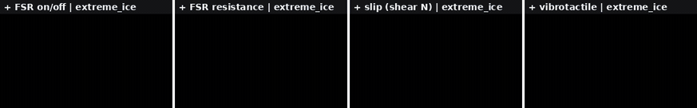 |
| **ice μ = 0.05** |
| 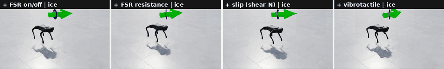 |
| **glue μ = 3** |
| 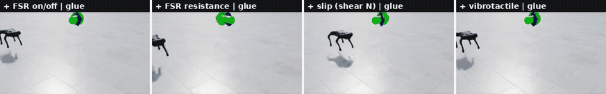 |

### Dead sensors: where proprioception wins

Proprioception only · all tactile with working sensors · the same all-tactile policy with every foot sensor dead.

| regular ground |
|---|
| 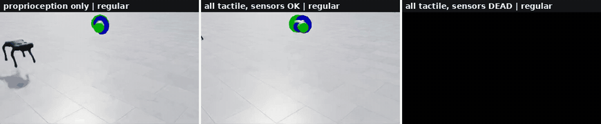 |
| **ice** |
| 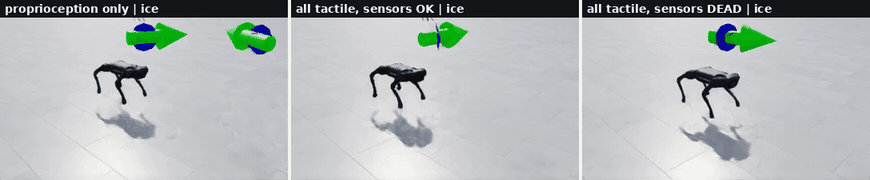 |

---

## Results and comparisons

**Protocol.** Each policy runs on all seven surfaces at once, with 128 robots per surface (896 in total), for 20 s. The command is 0.8 m/s forward, with a 0.5 rad/s turn in the second half. There are no random pushes. *Velocity error* is the time-averaged ‖v<sub>xy</sub> − v<sub>cmd</sub>‖. A *fall* means the body tilted more than 60° or, on flat ground, the base dropped below 0.15 m at any time. *Foot slip* is the horizontal foot speed while that foot carries > 3 N.

Every tactile number is compared with proprioception only on the same surface and condition, using a 95 % bootstrap confidence interval over robots (2000 resamples). **Bold** means tactile is significantly better; ▼ means proprioception is significantly better; plain means no significant difference. The complete tables, including foot slip and every condition, are in [`results/tables.md`](results/tables.md). Per-robot raw results are in `results/metrics_*.json`.

<p align="center"></p>

### Flat ground: velocity-tracking error [m/s] ↓

| policy | extreme ice<br>μ=0.01 | ice<br>μ=0.05 | wet<br>μ=0.2 | regular<br>μ=0.8 | sticky<br>μ=2.0 | glue<br>μ=3.0 | extra sticky<br>μ=5.0 | all surfaces |
|---|---:|---:|---:|---:|---:|---:|---:|---:|
| proprioception only | 0.767 | 0.662 | 0.453 | 0.218 | 0.315 | 0.298 | 0.312 | 0.432 |
| + FSR on/off | **0.737** | **0.594** | **0.247** | **0.175** | **0.224** | **0.230** | **0.224** | **0.347** |
| + FSR resistance | 0.769 | 0.674 ▼ | **0.410** | **0.180** | **0.190** | **0.193** | **0.190** | **0.372** |
| + slip (shear N) | 0.768 | 0.695 ▼ | 0.477 | 0.209 | **0.276** | **0.244** | **0.265** | 0.419 |
| + vibrotactile | **0.748** | **0.637** | **0.371** | 0.241 ▼ | 0.315 | 0.301 | 0.294 | 0.415 |
| + all tactile | **0.754** | **0.637** | **0.283** | **0.164** | **0.176** | **0.183** | **0.178** | **0.339** |

### Flat ground: distance walked in 20 s [m] ↑

| policy | extreme ice<br>μ=0.01 | ice<br>μ=0.05 | wet<br>μ=0.2 | regular<br>μ=0.8 | sticky<br>μ=2.0 | glue<br>μ=3.0 | extra sticky<br>μ=5.0 | all surfaces |
|---|---:|---:|---:|---:|---:|---:|---:|---:|
| proprioception only | 0.7 | 2.9 | 7.2 | 13.1 | 10.4 | 10.9 | 10.7 | 8.0 |
| + FSR on/off | **1.3** | **4.6** | **12.6** | **15.6** | **13.3** | **13.3** | **13.4** | **10.6** |
| + FSR resistance | 0.7 | 2.7 ▼ | **8.2** | **17.0** | **15.5** | **15.4** | **15.5** | **10.7** |
| + slip (shear N) | 0.7 | 2.2 ▼ | 6.7 | **14.3** | **12.1** | **12.8** | **12.5** | **8.8** |
| + vibrotactile | **1.1** | **3.4** | **8.9** | 12.7 | **11.0** | **11.6** | **11.7** | **8.6** |
| + all tactile | **1.0** | **3.5** | **11.4** | **16.4** | **15.1** | **15.4** | **15.1** | **11.1** |

<p align="center">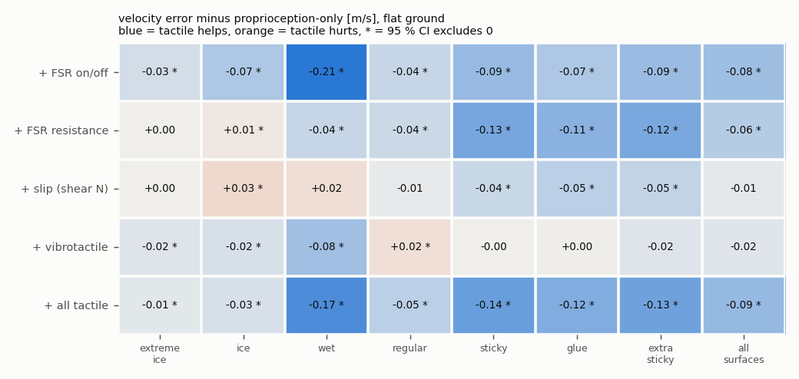</p>

### Rough ground (stairs, slopes, boxes, noise; random difficulty): velocity error [m/s] ↓

| policy | extreme ice<br>μ=0.01 | ice<br>μ=0.05 | wet<br>μ=0.2 | regular<br>μ=0.8 | sticky<br>μ=2.0 | glue<br>μ=3.0 | extra sticky<br>μ=5.0 | all surfaces |
|---|---:|---:|---:|---:|---:|---:|---:|---:|
| proprioception only | 0.780 | 0.764 | 0.637 | 0.572 | 0.646 | 0.660 | 0.659 | 0.674 |
| + FSR on/off | 0.773 | **0.720** | **0.590** | 0.551 | 0.616 | 0.638 | 0.649 | **0.648** |
| + FSR resistance | 0.782 | 0.742 | 0.615 | 0.582 | 0.622 | 0.648 | 0.644 | 0.662 |
| + slip (shear N) | 0.781 | 0.771 | 0.639 | 0.557 | **0.597** | **0.620** | 0.629 | **0.656** |
| + vibrotactile | 0.773 | 0.741 | 0.618 | 0.585 | 0.618 | 0.650 | 0.664 | 0.664 |
| + all tactile | 0.783 | 0.746 | **0.594** | **0.528** | **0.583** | **0.620** | **0.611** | **0.638** |

### Rough ground: fall rate ↓

| policy | extreme ice<br>μ=0.01 | ice<br>μ=0.05 | wet<br>μ=0.2 | regular<br>μ=0.8 | sticky<br>μ=2.0 | glue<br>μ=3.0 | extra sticky<br>μ=5.0 | all surfaces |
|---|---:|---:|---:|---:|---:|---:|---:|---:|
| proprioception only | 4.7% | 9.4% | 1.6% | 0.8% | 3.9% | 2.3% | 1.6% | 3.5% |
| + FSR on/off | 6.2% | 5.5% | 0.8% | 0.0% | 1.6% | 1.6% | 0.8% | 2.3% |
| + FSR resistance | 4.7% | **3.1%** | 0.0% | 0.0% | **0.0%** | 0.0% | 0.8% | **1.2%** |
| + slip (shear N) | **0.0%** | 4.7% | 4.7% | 1.6% | 0.8% | 1.6% | 0.0% | 1.9% |
| + vibrotactile | 7.8% | 9.4% | 3.9% | 1.6% | 3.9% | 5.5% | 1.6% | 4.8% |
| + all tactile | 2.3% | 3.9% | 0.0% | 0.8% | 0.8% | 1.6% | 0.0% | **1.3%** |

<p align="center">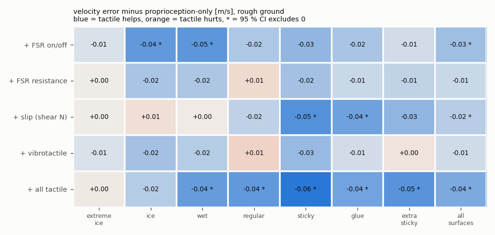</p>

On flat ground falls are rare for every policy (≤ 2.3 % on any surface), and no flat-ground fall-rate difference is significant.

### Sensor faults (flat ground, mean over all surfaces): velocity error [m/s] ↓

| policy | sensors OK | noisy sensors | dead sensors | distance, dead sensors (proprioception only: 8.0 m) |
|---|---:|---:|---:|---:|
| + FSR on/off | 0.347 | 0.365 | 0.725 ▼ | 1.59 m |
| + FSR resistance | 0.372 | 0.372 | 0.799 ▼ | 0.06 m |
| + slip (shear N) | 0.419 | 0.414 | 0.655 ▼ | 3.00 m |
| + vibrotactile | 0.415 | 0.417 | 0.551 ▼ | 5.45 m |
| + all tactile | 0.339 | 0.347 | 0.800 ▼ | 0.03 m |

"Noisy" means 5× the nominal sensor noise, with 10 % of readings replaced by another foot's reading (and 10 % of FSR bits flipped). "Dead" means every sensor reads "no contact": FSR 0, resistance open-circuit at 1 MΩ, shear and slip 0, vibration 0. The proprioception-only policy has no tactile input, so its error is 0.432 m/s in every column.

<p align="center">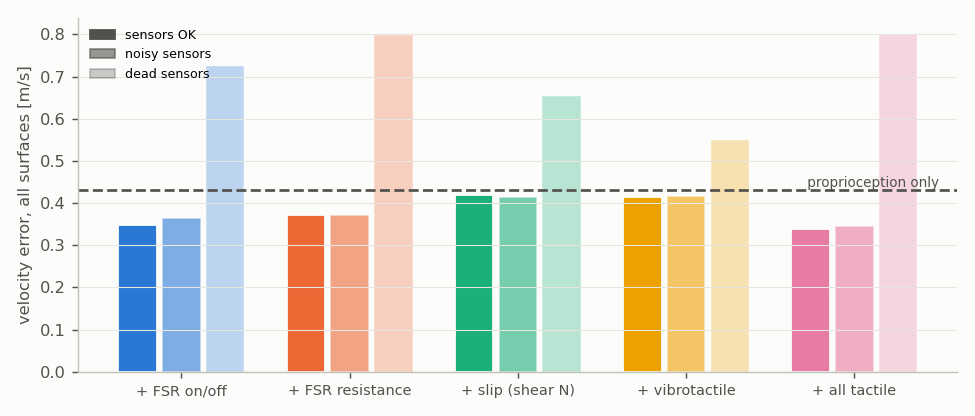</p>

### What the comparisons say

- **Contact timing is the useful signal.** The binary FSR alone gets most of the gain, and the four sensors combined are only slightly better than FSR on/off on flat ground (0.339 vs 0.347 m/s). My reading: knowing exactly *when* each foot is loaded lets the policy time push-off and swing without inferring it from joint torques and velocities. That matters most when the foot sticks (glue) or skids at touchdown (wet). This is an interpretation; I did not isolate it.
- **High friction is a problem for proprioception, not only low friction.** The proprioception-only policy's error rises from 0.218 m/s on regular ground to 0.315 on sticky, 0.298 on glue and 0.312 on extra-sticky. The FSR-resistance and all-tactile policies stay at their regular-ground error (≈ 0.18 m/s) all the way to μ = 5, and FSR on/off stays within 0.06 m/s of it.
- **The slip sensor makes the policy cautious.** "+ slip" is the only policy that slips *less* than proprioception only on every flat surface (2.37 vs 2.84 m/s on extreme ice). It pays for that in speed: on ice it walks 2.2 m against 2.9 m. FSR on/off, FSR resistance and vibrotactile slip *more* than proprioception only on every surface, and all-tactile slips more on ice and wet ground but less on regular and sticky ground. These policies walk faster and accept more slip.
- **The vibrotactile sensor is the weakest alone but the most fault-tolerant.** It helps on wet ground and very slightly on ice, and is slightly worse than proprioception only on regular ground. With dead sensors, its policy still walks 5.4 m: it leans on touch the least.
- **Fall rates.** Only rough ground produces enough falls to compare. There, all-tactile (1.3 %) and FSR-resistance (1.2 %) both fall significantly less than proprioception only (3.5 %). Vibrotactile alone does not (4.8 %).

---

## When proprioception wins

These are the cases where the proprioception-only policy is *significantly* better (95 % CI); the full list is in [`results/proprioception_wins.md`](results/proprioception_wins.md):

1. **When the tactile sensors fail.** This is by far the largest effect. Every tactile policy is worse than proprioception only with dead sensors, on every surface. All-tactile and FSR-resistance stand still (0.03 m and 0.06 m in 20 s). FSR on/off manages 1.6 m, slip 3.0 m and vibrotactile 5.4 m, against 8.0 m for proprioception only. During training a foot reading "no load" on all four legs always meant the robot was in the air. So the policy does the sensible thing for a robot in the air: nothing. A broken cable, a worn FSR or a sensor that saturates on a new surface would cause this on hardware. Noisy sensors are *not* a problem (see the fault table above).
2. **On ice, for the policies that sense force magnitude.** On ice (μ = 0.05), FSR resistance (error 0.674 vs 0.662 m/s; 2.7 vs 2.9 m) and slip (0.695 m/s; 2.2 m) are significantly worse than proprioception only. Slip is also worse on rough ice (2.0 vs 2.6 m). On ice these sensors report large slip and low, erratic loads, and the policies respond by slowing down. My interpretation is that they treat it as a cue to be careful. That is safe (the slip policy did not fall once on rough extreme ice) but loses ground.
3. **On regular ground, for the vibrotactile policy alone.** Its error is 0.241 vs 0.218 m/s. Accelerometer energy carries little information on ordinary ground, and the extra noisy input costs a little.
4. **For foot slip, if keeping slip low is the goal.** FSR on/off, FSR resistance and vibrotactile slip more than proprioception only on every surface. All-tactile slips more on ice and wet ground (for example 1.82 vs 1.72 m/s on wet). They walk faster and further, so this is a trade-off, not a failure. It still matters when slipping itself is the risk, for example near an edge.
5. **On extreme ice everyone is close.** At μ = 0.01 all six policies make 0.65–1.35 m of progress in 20 s, and the differences are a few hundredths of a m/s. Physics, not sensing, is the limit there.

**Rule of thumb from these results:** add touch when friction is moderate to high, or changes from one surface to the next, and the sensors are reliable. Keep a proprioception-only fallback, or train with sensor dropout, if a sensor can fail. Neither costs much on ice, where touch has little to add.

---

## The sensors

All four are Isaac Lab observation terms in [`tactile_loco/sensors.py`](tactile_loco/sensors.py). Each gives one value (two for slip) per foot (FL, FR, RL, RR). They are added to both the actor and the critic observations and computed from quantities a real foot sensor can measure:

| sensor | per foot | model |
|---|---|---|
| **FSR on/off** | 1 bit | 1 if the normal load F<sub>n</sub> > 3 N, else 0; 2 % of bits flipped (noise). |
| **FSR resistance** | R in MΩ | Raw resistance of an Interlink FSR-402-like sensor: open (1 MΩ) below 0.2 N, otherwise R = 150 kΩ · F<sub>n</sub><sup>−0.85</sup>, clipped to [0.5 kΩ, 1 MΩ]; ±5 % multiplicative noise. |
| **Slip ("slide N")** | F<sub>t</sub> in N, v<sub>slip</sub> | The tangential (friction / shear) force between foot and ground in newtons, from PhysX friction reporting (`ContactSensorCfg(track_friction_forces=True)`, filtered against the ground mesh). Scaled by 1/50 so 50 N reads as 1.0. Also the foot's horizontal speed while it carries load. |
| **Vibrotactile** (the extra sensor I chose) | log(1 + ‖a‖/g) | A MEMS accelerometer in the foot tip. Stick-slip on ice and sudden release from glue show up as high-frequency foot accelerations that joint encoders don't see directly; 0.02 noise. |

In a quick probe with random actions, the simulated sensors behave as expected: shear force rises with friction (0.02 N on extreme ice to 6.2 N on extra-sticky), and slip speed falls with it (see `scripts/probe_sensors.py`).

**Surfaces.** Each robot gets one foot–ground friction at startup:

| | extreme ice | ice | wet | regular | sticky | glue | extra sticky |
|---|---|---|---|---|---|---|---|
| static / dynamic μ | 0.01 / 0.005 | 0.05 / 0.03 | 0.2 / 0.15 | 0.8 / 0.6 | 2.0 / 1.8 | 3.0 / 2.5 | 5.0 / 4.0 |

Extreme ice, glue and extra-sticky use the values from the original project's configs (below). The terrain material has μ = 1 with combine mode `multiply`, so the foot material alone sets the contact friction.

---

## Setup and training

- **Simulator:** Isaac Sim 4.5 + Isaac Lab (`isaaclab` 0.41.5, commit `88d94ea`), PhysX GPU, 4096 robots, 200 Hz physics, 50 Hz policy.
- **Task:** [robot_lab](https://github.com/fan-ziqi/robot_lab) v2.3.2 `UnitreeA1RoughEnvCfg`. This is velocity tracking on a rough-terrain curriculum (pyramids, stairs, boxes, slopes, noise), with robot_lab's reward terms, domain randomization and pushes. The policy observation is robot_lab's default (base angular velocity, gravity direction, command, joint positions and velocities, previous action) plus the selected tactile terms. The robot is Isaac Lab's USD A1 asset, because robot_lab's URDF A1 needs a newer URDF importer than Isaac Sim 4.5 ships.
- **Learning:** PPO from rsl-rl 3.0.1, robot_lab's A1 hyper-parameters ([512, 256, 128] MLPs, 24 steps per env per iteration), 2000 iterations, seed 42. Each policy takes about 80 min on one RTX 4090, two at a time.
- **Training curves:** the proprioception-only policy ends with the *highest* training reward (58.0 vs 50.4–56.3). It also reaches the *lowest* terrain-curriculum level (2.26 vs 2.40–2.71 for the tactile policies). The tactile policies climbed to harder terrain, where reward is lower, so training reward is not comparable across policies. The evaluation above uses fixed, identical terrain for all.

```bash
# Isaac Lab (Isaac Sim 4.5) env, then:
git clone https://github.com/fan-ziqi/robot_lab && cd robot_lab && git checkout v2.3.2
pip install -e source/robot_lab --no-deps && cd ..
git clone https://github.com/An-Axolotl/legged-tactile && cd legged-tactile
export ROBOT_LAB=$PWD/../robot_lab
```

## Reproducing everything

```bash
bash scripts/train_all.sh        # 6 policies, ~4 h on one RTX 4090 (logs/rsl_rl/tactile_a1_<variant>/)
bash scripts/eval_all.sh         # 22 evaluations + 13 video runs + tables/charts/GIFs, ~2 h
# single runs
python scripts/train.py --task Tactile-A1-all-v0 --headless                       # variants: baseline fsr resistance slip vibro all
python scripts/evaluate.py --variant all --headless [--terrain rough] [--fault dead|noisy]
python scripts/evaluate.py --variant all --headless --enable_cameras --video --surfaces ice,glue
python scripts/probe_sensors.py --headless                                        # sensor sanity check
```

The trained policies are in [`checkpoints/`](checkpoints). `evaluate.py` uses them automatically when there is no local `logs/` directory.

---

## Caveats and honest notes

- **One training seed per policy.** The confidence intervals cover robot-to-robot variation within one trained policy, not variation between training runs. Small differences, such as a few hundredths of a m/s, could change with another seed. The large effects (glue/sticky gains, dead-sensor freezing) are well beyond that.
- **Simulation only.** The sensor models are plausible, not calibrated against hardware. PhysX friction reporting gives the slip sensor something cleaner than a real shear sensor would.
- **Friction is fixed per robot for its whole training run and evaluation.** I did not test surfaces that change under a single robot (an ice patch in the middle of a walk). That is the obvious next experiment.
- **Faults are evaluation-only.** No policy was trained with sensor dropout, which is why the dead-sensor failure is so stark. Training with dropout should fix most of it, but I haven't tested that.
- The fall criterion is a geometric threshold. On rough ground only the tilt criterion is used.

---

## Original version of the project

This is a re-implementation. The earlier version of this project trained A1 policies with foot-contact sensing on icy and sticky terrain, using robot_lab and Isaac Lab. Its tactile code, logs and tactile-policy recordings could not be recovered: they were not on this machine, in my W&B projects or in Google Drive. What survived is kept for reference:

- [`original_2025_configs/`](original_2025_configs): the recovered robot_lab environment configs with the ice (μ 0.01 / 0.005), glue (3.0 / 2.5) and extra-sticky (5.0 / 4.0, re-weighted rewards) variants. They are derived from robot_lab, so they keep its Apache-2.0 license.
- [`media/original_2025/`](media/original_2025): clips of the original **proprioception-only** policies on regular, icy, glue and extreme-glue terrain.

| regular | icy | glue | extreme glue |
|---|---|---|---|
| 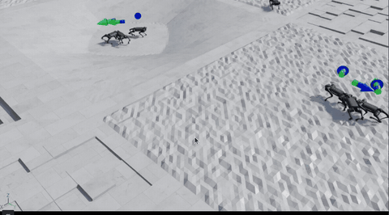 | 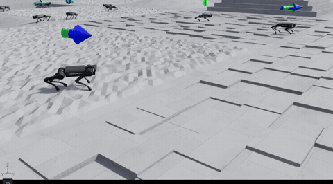 | 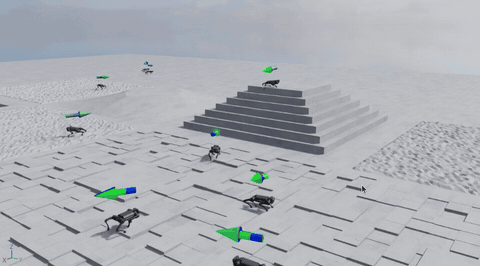 | 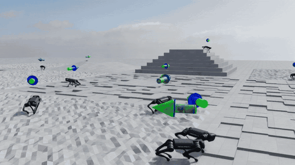 |

All numbers and videos in this README come from the new runs, not the original ones.

---

## Repository layout

```
tactile_loco/
  sensors.py        the four foot sensors, sensor-fault modes, per-robot surface (friction) event
  env_cfg.py        Tactile-A1 environments on top of robot_lab's A1 rough task (one per sensor set)
  agents.py         PPO configs;  __init__.py registers Tactile-A1-<variant>-v0
scripts/
  train.py, train_all.sh       training (wraps robot_lab's RSL-RL train script)
  evaluate.py, eval_all.sh     metrics and videos
  make_media.py                statistics, tables, charts and GIFs
  probe_sensors.py             sensor sanity check
checkpoints/        the six trained policies (rsl-rl, 2000 iterations)
results/            per-robot metrics (metrics_*.json), summary.json with CIs, tables.md, proprioception_wins.md
media/              GIFs, MP4s and charts;  original_2025/ clips from the original project
original_2025_configs/   recovered configs from the original project (Apache-2.0)
```

## Acknowledgements

- **[Isaac Sim / Isaac Lab](https://github.com/isaac-sim/IsaacLab)** (NVIDIA and the Isaac Lab contributors): simulation, contact and friction sensing, and the A1 asset.
- **[robot_lab](https://github.com/fan-ziqi/robot_lab)** (Ziqi Fan): the A1 rough-terrain locomotion task this builds on.
- **[rsl_rl](https://github.com/leggedrobotics/rsl_rl)** (ETH Zürich Robotic Systems Lab): PPO.
- Unitree Robotics for the A1 robot model.

## Citation

```bibtex
@misc{anaxolotl2026leggedtactile,
  author       = {Fay, Kehlani},
  title        = {Legged Tactile: Foot Touch Sensing for Quadruped Locomotion on Ice, Glue and Everything in Between},
  year         = {2026},
  howpublished = {Blog post / code repository, \url{https://github.com/An-Axolotl/legged-tactile}}
}
```

## License

MIT (see [`LICENSE`](LICENSE)), except [`original_2025_configs/`](original_2025_configs), which is derived from robot_lab and keeps its Apache-2.0 license. `tactile_loco/env_cfg.py` imports robot_lab (Apache-2.0) at runtime.
