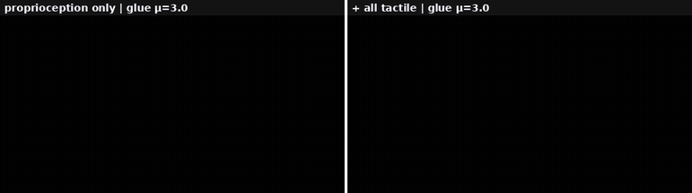
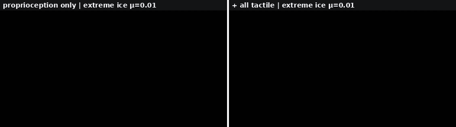
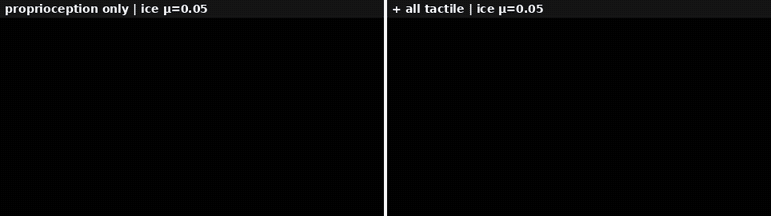
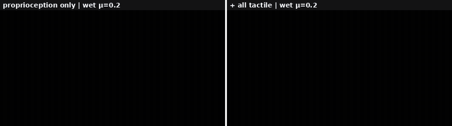
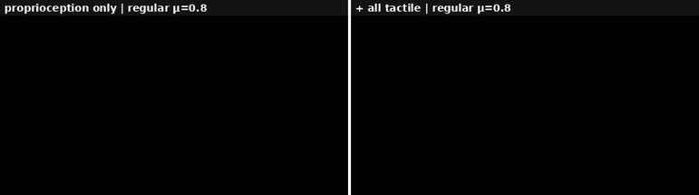
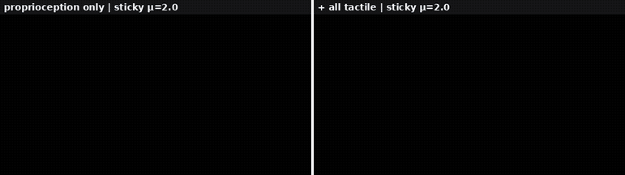
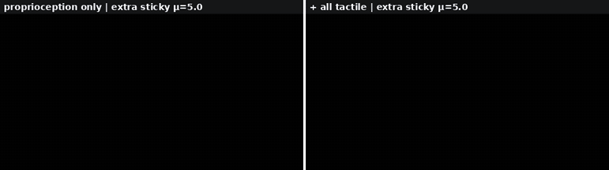
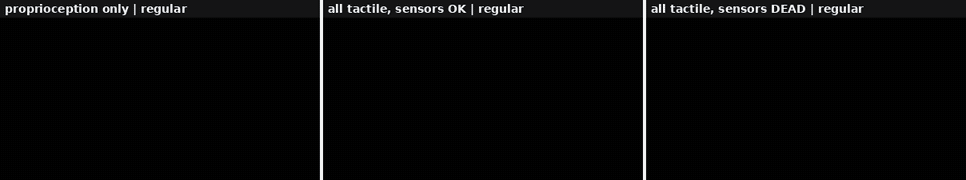
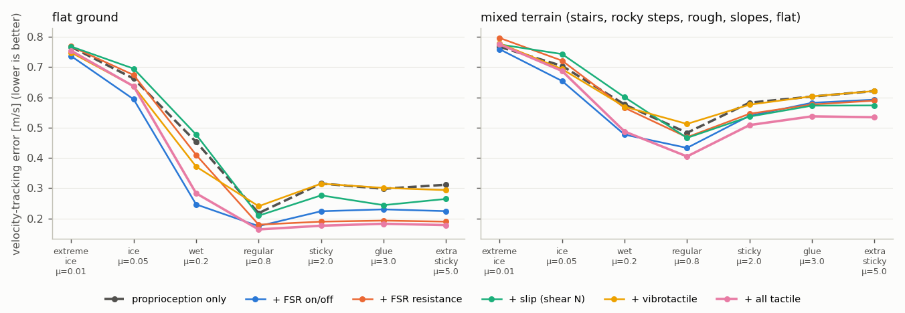

# Legged Tactile

**Foot touch sensing for a quadruped walking on ice, glue and everything in between**, plus where plain proprioception (joint encoders + IMU) still wins.

*This is a re-implementation of my former, lost code.* The original tactile code and recordings are gone; what survived is in [`original_2025_configs/`](original_2025_configs) and [`media/original_2025/`](media/original_2025). Every result below comes from the new runs.



A Unitree A1 PPO policy (Isaac Lab, [robot_lab](https://github.com/fan-ziqi/robot_lab)) with four simulated foot sensors: **FSR on/off**, **raw FSR resistance**, **slip** (shear force in N + slip speed) and a **vibrotactile** accelerometer. I trained six policies: proprioception only, each sensor alone, and all four together. I tested them on a mixed field of stairs, rocky steps, rough ground, slopes and flat ground, with seven foot-ground frictions from extreme ice (μ 0.01) to extra-sticky (μ 5). That is 128 robots per surface, 20 s each.

## Results at a glance

- **Touch helps on everything from wet to extra-sticky ground.** On mixed terrain, all-tactile cuts velocity-tracking error by 9 % (0.62 → 0.56 m/s) and walks 39 % further (4.2 → 5.8 m). On flat ground it cuts the error by 21 %.
- **A binary FSR gets most of it.** FSR on/off alone: 0.58 m/s.
- **On ice nothing helps much.** With μg ≈ 0.1–0.5 m/s² of available grip, no policy tracks the command.
- **Proprioception wins when sensors die.** With dead foot sensors the all-tactile policy stands still (0.03 m in 20 s). Noisy sensors cost nothing.

## Videos

Mixed terrain, 32 robots per surface, 0.8 m/s forward then turning. Left: proprioception only; right: all tactile. The number is the mean distance walked in 20 s (128 robots). Green arrow = command, blue = actual velocity. MP4s are in [`media/videos/`](media/videos).

| proprioception only · all tactile | |
|---|---|
|  | **extreme ice**<br>μ = 0.01<br><br>1.3 → 1.3 m |
|  | **ice**<br>μ = 0.05<br><br>3.1 → 3.1 m |
|  | **wet**<br>μ = 0.2<br><br>5.0 → 7.1 m |
|  | **regular**<br>μ = 0.8<br><br>7.1 → 9.9 m |
|  | **sticky**<br>μ = 2.0<br><br>4.7 → 6.9 m |
|  | **glue**<br>μ = 3.0<br><br>4.3 → 6.2 m |
|  | **extra sticky**<br>μ = 5.0<br><br>3.9 → 6.3 m |

**Dead sensors:** proprioception only · all tactile · all tactile with every foot sensor dead.



## Results



**Mixed terrain, velocity-tracking error [m/s] ↓.** **Bold** = tactile significantly better than proprioception only, ▼ = significantly worse (95 % bootstrap CI over robots).

| | extreme ice<br>μ 0.01 | ice<br>μ 0.05 | wet<br>μ 0.2 | regular<br>μ 0.8 | sticky<br>μ 2.0 | glue<br>μ 3.0 | extra sticky<br>μ 5.0 | all |
|---|---:|---:|---:|---:|---:|---:|---:|---:|
| proprioception only | 0.77 | 0.70 | 0.58 | 0.48 | 0.58 | 0.60 | 0.62 | 0.62 |
| + FSR on/off | 0.76 | **0.65** | **0.48** | **0.43** | **0.54** | 0.58 | 0.59 | **0.58** |
| + FSR resistance | 0.80 ▼ | 0.72 | 0.57 | 0.47 | 0.55 | 0.58 | 0.59 | 0.61 |
| + slip (shear N) | 0.78 | 0.74 ▼ | 0.60 | 0.47 | **0.54** | 0.57 | **0.57** | 0.61 |
| + vibrotactile | 0.78 | 0.69 | 0.57 | 0.51 | 0.58 | 0.60 | 0.62 | 0.62 |
| + all tactile | 0.78 | 0.69 | **0.49** | **0.41** | **0.51** | **0.54** | **0.53** | **0.56** |

**Mixed terrain, distance in 20 s [m] ↑**

| | extreme ice<br>μ 0.01 | ice<br>μ 0.05 | wet<br>μ 0.2 | regular<br>μ 0.8 | sticky<br>μ 2.0 | glue<br>μ 3.0 | extra sticky<br>μ 5.0 | all |
|---|---:|---:|---:|---:|---:|---:|---:|---:|
| proprioception only | 1.3 | 3.1 | 5.0 | 7.1 | 4.7 | 4.3 | 3.9 | 4.2 |
| + FSR on/off | **2.3** | **4.4** | **7.8** | **8.7** | **6.0** | 5.0 | **4.7** | **5.5** |
| + FSR resistance | 0.9 | 2.6 | 5.3 | **8.5** | **6.3** | **5.4** | **5.2** | **4.9** |
| + slip (shear N) | 0.7 ▼ | 1.7 ▼ | 4.3 ▼ | 7.6 | **6.0** | 5.2 | **5.0** | 4.4 |
| + vibrotactile | 1.3 | 3.2 | 5.1 | 6.6 | 5.1 | 4.6 | 4.2 | 4.3 |
| + all tactile | 1.3 | 3.1 | **7.1** | **9.9** | **6.9** | **6.2** | **6.3** | **5.8** |

**Sensor faults, mixed terrain** (error in m/s, mean over surfaces). Noisy = 5× noise + 10 % false readings; dead = every sensor reads "no contact".

| | sensors OK | noisy | dead | distance with dead sensors |
|---|---:|---:|---:|---:|
| + FSR on/off | 0.577 | 0.570 | 0.744 ▼ | 1.27 m |
| + FSR resistance | 0.609 | 0.612 | 0.798 ▼ | 0.11 m |
| + slip (shear N) | 0.610 | 0.615 | 0.719 ▼ | 1.82 m |
| + vibrotactile | 0.622 | 0.622 | 0.675 ▼ | 2.98 m |
| + all tactile | 0.562 | 0.570 | 0.800 ▼ | 0.03 m |
| *proprioception only* | 0.620 | – | – | 4.20 m |

Falls are rare on mixed terrain for every policy (≤ 5 % on any surface, mean ≤ 0.7 %). The flat- and rough-ground runs, foot-slip numbers and every per-surface CI are in [`results/tables.md`](results/tables.md) and [`results/summary.json`](results/summary.json).

## When proprioception wins

1. **Dead or disconnected sensors.** Every tactile policy is worse than proprioception only on every surface. All-tactile and FSR-resistance freeze. In training, "no load on any foot" only ever meant "in the air". Vibrotactile degrades least (3.0 m vs 4.2 m).
2. **Ice, for the force-magnitude sensors.** The slip-sensor policy slows right down on ice (1.7 vs 3.1 m) and extreme ice (0.7 vs 1.3 m). FSR resistance is also worse on extreme ice. They play it safe and lose ground.
3. **Foot slip.** Most tactile policies walk faster and slip more. Only the slip-sensor policy slips less than proprioception only.
4. **The vibrotactile sensor alone** adds nothing on mixed terrain.

**Rule of thumb:** use touch when friction is moderate to high or varies, and the sensors are reliable. Keep a proprioception fallback, or train with sensor dropout, if they can fail.

## Sensors

| sensor | per foot | model |
|---|---|---|
| FSR on/off | 1 bit | load > 3 N, 2 % bit flips |
| FSR resistance | MΩ | FSR-402-like: open (1 MΩ) below 0.2 N, else 150 kΩ·F<sup>−0.85</sup>, ±5 % noise |
| slip | N, m/s | shear (friction) force from PhysX friction reporting + foot speed while loaded |
| vibrotactile | log(1+‖a‖/g) | foot-tip accelerometer, picks up stick-slip and release from glue |

Code: [`tactile_loco/sensors.py`](tactile_loco/sensors.py). Sensors go into both actor and critic observations. Each robot gets one surface for its whole run.

## Run it

Isaac Sim 4.5 + Isaac Lab, robot_lab v2.3.2, rsl-rl 3.0.1, one RTX 4090.

```bash
git clone https://github.com/fan-ziqi/robot_lab && (cd robot_lab && git checkout v2.3.2 && pip install -e source/robot_lab --no-deps)
git clone https://github.com/An-Axolotl/legged-tactile && cd legged-tactile && export ROBOT_LAB=$PWD/../robot_lab
bash scripts/train_all.sh     # 6 policies, ~4 h  (or use checkpoints/)
bash scripts/eval_all.sh      # all evaluations, videos, tables, charts, this README, ~3 h
python scripts/evaluate.py --variant all --headless --terrain mixed [--fault dead|noisy]
```

## Notes

- One training seed per policy; CIs are over robots, not training runs. The large effects are well beyond that.
- Simulation only; the sensor models are plausible, not calibrated.
- The proprioception-only policy has the highest *training* reward because it stayed on easier curriculum terrain (level 2.26 vs 2.40–2.71). Evaluation uses identical terrain for all.
- Friction doesn't change under a robot mid-walk (e.g. stepping onto an ice patch). That's the next experiment.

## Acknowledgements · Citation · License

Built on [Isaac Sim / Isaac Lab](https://github.com/isaac-sim/IsaacLab), [robot_lab](https://github.com/fan-ziqi/robot_lab) (Ziqi Fan) and [rsl_rl](https://github.com/leggedrobotics/rsl_rl) (ETH RSL); A1 model by Unitree.

```bibtex
@misc{anaxolotl2026leggedtactile,
  author       = {Fay, Kehlani},
  title        = {Legged Tactile: Foot Touch Sensing for Quadruped Locomotion on Ice, Glue and Everything in Between},
  year         = {2026},
  howpublished = {Blog post / code repository, \url{https://github.com/An-Axolotl/legged-tactile}}
}
```

MIT, except [`original_2025_configs/`](original_2025_configs) (derived from robot_lab, Apache-2.0).
